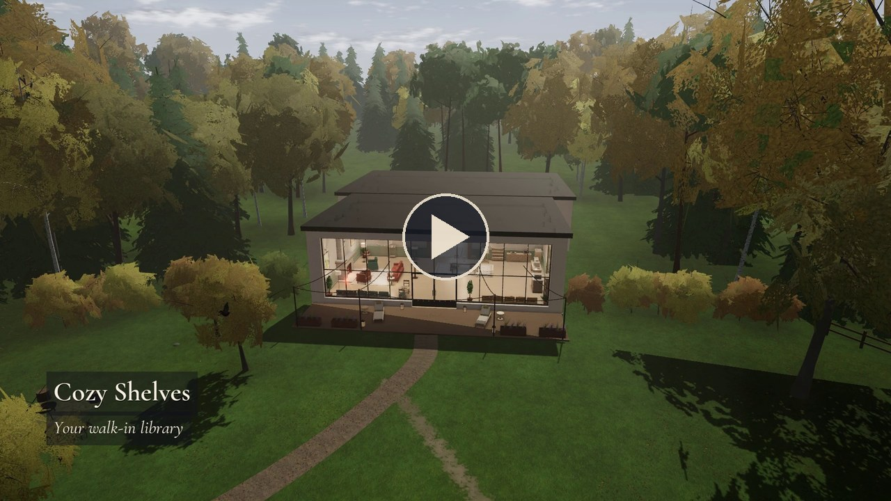

<p align="center"></p>

# Cozy Shelves

*Deutsch: [README.de.md](README.de.md)*

<p align="center"><a href="https://github.com/regard2462/Cozy-Shelves/releases/download/v0.10.3/cozy-shelves-demo.mp4"></a><br><a href="https://github.com/regard2462/Cozy-Shelves/releases/download/v0.10.3/cozy-shelves-demo.mp4">Watch the demo video (4 minutes, with music)</a></p>

Cozy Shelves is a walkable 3D library for the books on your own computer. You walk through a cosy hall
with a fireplace, a glass front and a garden with a lake, into a book room where your folders stand as departments
on oak shelves. You take books from the shelves, sit down by the fire and read them full screen, with
bookmarks, notes, a dictionary, a full-text search over all your books and read-aloud voices that run on your
computer. Audiobooks from your own folders, newspapers, podcasts, a media library of public broadcasters and
English-language sources, an online catalogue of free books, a reading browser, a world map, a chess table and two
computers with games are part of the house. Outside, the seasons change, birds fly over the lake and deer come out of
the wood.

Cozy Shelves runs on Windows 10 and 11 and on Linux x64 (Electron, three.js). Until 0.7.2 it was called Lesesaal, from 0.8.0 to 0.9.2 Cozystacks. The interface is in German and English. It works with
keyboard and mouse or with a game controller.

## Features

**The library**
- Your folders become departments, their sub folders shelves, or Cozy Shelves sorts the books itself by title, keywords
  and ISBN into fixed departments (novels, crime, history, science …).
- One large book room holds all departments along its walls, each under its own sign; a board in the passage shows
  where each one stands. A library too large for the walls shows one department at a time, and the department wheel
  (hold `Tab`) switches it; otherwise the wheel takes you straight to any department.
- Books stand at eye level on lit shelves. A book you look at slides out and turns towards you, stopping just short
  of facing you, so that its spine and the page block stay in view; it takes the proportions of its cover and shows it
  whole. The cover stands right of the middle without a frame, the keys on a small bar below it: `E` puts the book
  into your basket, `R` opens it, `C` marks it as read.
- At the start and the end of every row and next to a gap, a book shows its cover on its side as well, trimmed like a
  print and never stretched; a book without a cover shows its title card.
- A "Read" shelf for the books you finished; your reading goal and streak are in the statistics on the computers.
- Books that exist twice (in two folders, as EPUB and PDF) stand on the shelves once. Every shelf can be sorted by
  title, author, year, publisher, series, recently added or recently read.
- Recommendations with a cover lie on a sloped board in front of the shelves, must-read books first (a shortcut
  to a book in your folder marks it as a must-read: a `.lnk` on Windows, a symbolic link on Linux).
- Missing covers and metadata (author, year, publisher, ISBN, series) come from book catalogues (Open Library,
  Goodreads, Apple Books, the German National Library, the Internet Archive, Amazon's pictures by ISBN, Google Books
  with your own key), otherwise from the image search of Bing, Yandex and DuckDuckGo. "Load all covers now" fetches
  them all at once; the book info lets you choose another cover.
- A "recently read" shelf, a return desk, reading statistics and a reading diary on the computers.
- Formats: PDF, EPUB, MOBI/AZW/AZW3, FB2, CBZ, TXT, Markdown, HTML, DOCX, RTF. New files are noticed while the app
  runs; moved books keep their reading position.

**Reading**
- Full-screen reader with page colours (white, paper, sepia, night, also for PDF pages), fonts (EB Garamond, Literata,
  Source Serif, Palatino, Atkinson Hyperlegible Next, Segoe UI), font size and page width, bookmarks, notes, search,
  a dictionary, translation and Wikipedia look-ups.
- A text view for PDFs: the text of the pages set anew as flowing text in your font, with headings, lists, footnotes
  and pictures kept.
- Full-text search over all books, with the page and the passage of every hit; the index is built in the background
  (SQLite FTS5).
- Read-aloud in German (Piper/VITS voices and the Kokoro voice "Martin") and English (Kokoro), all running locally.
  Every paragraph is read in its own language, chess notation in words; a voice menu sits at the read-aloud icon. A
  voice is downloaded once from Hugging Face, or all voices at once.
- Chess books get a chessboard next to the page. A diagram cut out of the page is read offline by a small neural network
  (hatched squares, coordinates and arrows included) and set on the board.

**Audiobooks**
- Folders of MP3, M4A, M4B, AAC, OGG, OPUS, FLAC or WAV files become audiobooks, with chapters, covers and series from
  their tags.
- A player with chapters, speed from 0.75 to 2.5 and a sleep timer; the position is kept per audiobook. The audiobook
  keeps playing while you walk; a cabinet of audiobook boxes stands in the hall (empty until you add a folder, `E`
  there opens the audiobooks).

**The house and the garden**
- A hall with a fireplace, armchairs, a sofa, window seats and a projection screen; glass doors open onto a terrace.
  Every lamp can be switched off and on.
- Walls in calm colours or as a graffiti mural painted by the program in the language of the interface; ten floors
  to choose from (oak, herringbone parquet, walnut, maple, marble, terracotta, stone, terrazzo, carpet, cement tiles).
- A garden with paths, a lake with a jetty, benches, reeds and water lilies, a fire bowl with log stumps and a feeding
  station with a wildlife hide. Spring, summer, autumn and winter by the calendar or by choice.
- In winter the lake freezes over and carries you (a little slippery). You, the deer, foxes and birds leave tracks in
  the snow that blow over after some minutes; the path is trodden, the boards of the terrace and the jetty show
  through thin snow.
- Deer, foxes and now and then a wolf, often in view of the windows. Come too close and a deer trots off a little way,
  stops within sight, looks back and grazes on elsewhere. Sparrows, finches, tits, blackbirds, crows, swallows and a buzzard
  in real flight; koi and frogs in the lake.
- A night sky with some 5300 stars, the Milky Way and the moon in today's phase; brighter nights.
- Time of day: real time, day–night cycle, day only, night only (each with a day length of 10 minutes to 2 hours),
  fixed time, golden hour. Weather: clear, overcast, rain, thunderstorm or snow, with fog and wind where they fit,
  changing weather, or the real weather of a place (Open-Meteo).
- God rays, smoothly moving shadows of the trees, soft reflections in the windows, a plump tabby library cat that
  sleeps on the armchairs, blinks, purrs and likes to be petted.
- Sounds that follow the world: rain only when it rains, thunder after the lightning, birds, frogs and crickets in
  the garden, soft footsteps by the ground. Each sound can be switched off on its own.

**Media and more**
- Newspapers and magazines with full articles, in the language of the interface (or all of them); podcasts with a mini
  player.
- Mediathek: films and programmes of German, Austrian and Swiss public broadcasters, films in English from DW,
  NHK WORLD-JAPAN, arte, NASA, the Internet Archive and TED, live TV with 28 German programmes and DW English,
  FRANCE 24 English, Al Jazeera English and NHK WORLD-JAPAN. The quality is chosen as a resolution (1080p, 720p …).
  Downloads, and a film on the projection screen in the hall.
- A reading browser modelled on EinkBro: reading mode, tabs, bookmarks, ad blocker, "save as book".
- Online catalogue ("Fernleihe") of free books: Project Gutenberg, Standard Ebooks, Wikisource, Internet Archive,
  OAPEN, LibriVox, arXiv and others.
- A world map with country and city profiles, Wikipedia summaries and Google Street View. The overview is a quiet
  atlas drawn from the app's own data (soft country colours, lakes and great rivers, names of countries, capitals,
  cities and seas in the interface language, never overlapping) with four views: countries, continents, population
  density and GDP per head, each with a legend. Zoomed into a region, OpenStreetMap's map takes over, muted; its
  tiles come from OpenStreetMap's tile servers (the app identifies itself as Cozy Shelves and sends nothing about you or
  your books). The overview works offline.
- Chess against Stockfish and tactics puzzles; on the computers Go, Nine Men's Morris, draughts, Reversi, Mastermind,
  Sudoku, 2048, Minesweeper, Snake, Blocks, Solitaire, Memory and Lichess.
- A watercolour studio at an easel whose canvas shows the picture you painted last, a record player with calm
  generated music, your own music folder.

## Download and install

All packages are on the releases page.

**Windows**: unpack `CozyShelves-<version>-win64-portable.zip` anywhere (for example into `C:\Programme\CozyShelves`
or onto the desktop) and start `CozyShelves.exe`. Nothing is installed. If Windows SmartScreen warns about an unknown
publisher: *More info → Run anyway* (the program is not signed).

**Linux with Debian, Ubuntu or Mint**: `sudo apt install ./cozy-shelves_<version>_amd64.deb`. Cozy Shelves is then in the
application menu and starts with `cozy-shelves` in a terminal.

**Linux, other systems**: unpack `CozyShelves-<version>-linux-x64.tar.gz` and run `./cozy-shelves` in the program folder.
`./install-desktop-entry.sh` adds an entry to the application menu. If Cozy Shelves stops with a message about
`chrome-sandbox`, the system allows Chromium's sandbox only through that helper (Ubuntu 23.10 and later). Run
`sudo chown root:root chrome-sandbox && sudo chmod 4755 chrome-sandbox` once in the program folder.

Cozy Shelves sends no personal data anywhere. It uses the internet only for newspapers, Wikipedia, podcasts, the online
catalogue, the reading browser, the Mediathek, the world map (Wikipedia, Street View), missing covers and book
metadata (book catalogues and image search), the weather "Like outside" (Open-Meteo) and the one-time download of the
read-aloud voices. What leaves your computer are search terms only, such as the title, author and ISBN of a book or the
name of a place.

## First start

On the first start, and whenever no book folder is set, a card **"Welcome to Cozy Shelves"** appears over the start menu:

- **How the books are shelved**: "Sub folders are departments" (every folder inside the chosen folder becomes a
  department, its sub folders become shelves) or "Sort automatically" (Cozy Shelves puts every book into a department by
  its title, keywords and ISBN). Keys `1` and `2` or the arrow keys choose.
- **Choose a folder with books** (`Enter`) opens the folder dialog of the system. The card closes, and the shelves fill while
  the books are read in the background (a few minutes for some 750 PDFs the first time, instantly afterwards).
- **Later** (`Esc`) closes the card. The book room then shows four empty, furnished shelves under the sign "Your
  books", and a card on the shelf and the board in the passage say how books get in. The start page of the menu offers
  the card again.
- "Deutsch" and "English" at the bottom of the card switch the language at once.

More folders: *Esc → Settings → Book folders*. Cozy Shelves never adds a folder by itself. Audiobook folders are added
under *Settings → Audiobooks*.

## Controls

| Key | Action |
|---|---|
| `W` `A` `S` `D` / arrow keys, mouse | walk and look around, `Shift` walks faster; click into the view so that the mouse steers your gaze |
| left click, `E` | use what you look at: a book's card, sit down, computer, record player, radio, easel, encyclopedia, world map, newspaper rack, return desk, projector, an audiobook box, a lamp (off and on), the fire bowl, cat |
| `R` / `F` / `B` | read the book at once / book info / open the basket |
| `C` | mark the book you look at as read, again as unread |
| `Tab` | department wheel: hold, move the mouse, release. The centre (or `Q`) shows the places instead; release over one to go there |
| `Space` | jump, or stand up from a seat |
| `G` / `M` / `V` / `I` | places / record player / Mediathek / reading browser |
| `H` / `T` or `Ctrl`+`F` | audiobooks / full-text search |
| `Esc` / `F11` | menu / full screen |
| `K` `J` `L`, `P` `O` `X` | film, podcast or audiobook: pause, back, forward; film on the screen, in the window (audiobook: the player), stop |
| in a book | `←` `→` turn pages, `B` bookmark, `T` contents and notes, `F` search in the book, `Ctrl`+`F` search all books, `V` read aloud, `Shift`+`V` voice menu, `S` appearance, `Ctrl`+`+` / `Ctrl`+`−` / `Ctrl`+`0` font size, `X` text view of a PDF, `C` chessboard, `D` diagram onto the board |
| in the Mediathek player | `Space` or `K` pause, `J` `L` 10 s, `←` `→` 5 s, `F` full screen, `M` mute, `Q` quality |

A controller (Xbox, PlayStation and others with the standard layout) works everywhere: the left stick walks, the right
stick looks, `A` uses like `E`, `B` goes back, `X` jumps, `Y` opens the basket, `LB` and `RB` read a book or show its
info, `Start` opens the menu, `View` the places (held: the department wheel, where `LB` and `RB` switch between departments and places). Panels get a frame to move with the D-pad,
text fields an on-screen keyboard, and pressing the right stick shows a mouse pointer. *Settings → Controller* lists
every button.

The full guide, in German and English, is in the start menu and under *Esc → Guide*.

## Your data

Settings, reading positions, notes, the cover cache and the voice models live in the data folder,
`%APPDATA%\Cozy Shelves\` on Windows and `~/.config/Cozy Shelves/` on Linux. If you used Cozystacks (0.8.0 to 0.9.2)
or Lesesaal (up to 0.7.2), its folder (`%APPDATA%\Cozystacks\` or `%APPDATA%\Lesesaal\`) stays in use with everything
in it. The data folder also holds
the audiobooks and their positions (`audiobooks.json`, `audiobook-tags.json`, `audiobook-covers\`), the full-text index
(`fulltext\`) and the covers from the internet (`web-covers.json`). Deleting that folder resets Cozy Shelves. Your books and
audiobooks are never moved, renamed or changed.

When the graphics process ends (a driver hiccup, a crash), Cozy Shelves rebuilds its window and puts you back where you
stood, after an open panel such as a book has been closed. Each such event is noted with its time, reason and version
in `logs\gpu.log` in the same folder. Errors of the interface and the map's own check of its picture are noted in
`logs\renderer.log`.

## Browser version

Cozy Shelves also runs as a plain web page, slimmed down: `npm run build:web` writes a static site to `dist/web/` that any
static host can serve (also `http://localhost`, which counts as a secure context). The page reads a books folder you pick
in the browser and keeps settings, reading positions, bookmarks, notes, covers and the paintings of the easel in the
browser's IndexedDB. Your books never leave your computer; the page only reads them.

* **Browsers**: Edge, Chrome, Opera and other Chromium browsers remember the folder and ask for permission once after a
  restart. Firefox and Safari read the folder through the file dialog and need it again after every restart (the books
  keep their positions). WebGL 2 is required.
* **In the browser**: the whole world (hall, book room, garden, animals, weather, seasons), the shelves from your folders,
  covers out of the books, the reader with bookmarks and notes, the chess books and Stockfish, the computer with all
  games and Lichess, the world map with Wikipedia, the encyclopedia and the dictionary, the easel and the gallery, the
  record player, read-aloud through the browser's own speech output.
* **Not in the browser**: newspapers and podcasts, the Fernleihe, the Mediathek and the projection screen, the reading
  browser and Street View, audiobooks, the full-text index (`T` opens the computer's catalogue, whose text mode searches
  the first pages of the books), covers and metadata from the internet, Word and RTF files, own music and picture
  folders, the local voices (Martin, Thorsten, Kokoro). Those entries are hidden or say "desktop app only".
* **Build and host**: `npm run build:web`, then copy `dist/web/` to the host (about 23 MB, 7 MB of which is Stockfish and
  5 MB the EPUB and PDF engines, both loaded only when used). Relative addresses only, no server logic. For a look on
  this machine: `npx http-server dist/web -p 8099` and open `http://localhost:8099/`.
* **Check**: `npm run test:web` serves `dist/web` and drives it in the installed Microsoft Edge, headless and muted
  (`WEB_BOOKS=<test library>`, `WEB_INPUT=1` for the Firefox way through the file dialog, `SHOT_DIR`, `WEB_PROFILE`).

## Android app

Cozy Shelves also comes as an Android app, built on the browser version: `android/` holds a small Kotlin project whose
one screen is a WebView that shows the web build from the app's own assets and serves the books of a folder you pick.
What the browser version does works on the phone too; the touch screen gets controls of its own.

* **Install**: `cozy-shelves-<version>-release.apk` from the release page, allow the installation from that source once,
  open it. Android 8.0 (API 26) or newer, a phone or tablet with OpenGL ES 3.0. The app asks for no permission beyond
  the internet (Wikipedia, the dictionary, the weather, Lichess).
* **The books folder**: on the first start the welcome card opens the system's folder picker; choose the folder with
  your books (its sub-folders become departments and shelves, as on the desktop). Android keeps the permission, so
  the folder is read again at every start without a new pick; removing the folder in the settings gives it back. The
  books never leave the phone: nothing is copied, nothing is sent anywhere.
* **Controls**: the stick at the bottom left walks (pushed far out it runs; the running figure above it keeps
  running on), a drag on the right half of the screen looks around, the big hand button uses what the crosshair rests
  on, the buttons next to it read, open the info card and jump, the menu and the department wheel sit top left, the
  basket chip opens the basket. The phone's back button closes the open panel, leaves the reader, opens the menu in
  the world and leaves the app on the start menu. In the reader a tap on the page edge or a swipe turns the page; the
  phone may rotate there, the world stays in landscape.
* **What is different**: the same things are missing as in the browser version (newspapers, podcasts, the Fernleihe,
  the Mediathek, audiobooks, the full-text index, covers from the internet, Word and RTF files, the local voices;
  read-aloud uses the voices of Android). The graphics start at the low preset with 30 frames a second and a reduced
  render resolution, and the app lowers the resolution further by itself when the phone cannot keep up; your own choice
  in the settings always wins. On a phone the page is zoomed out a little so that the panels fit the screen.
* **Build**: `npm run build:android` runs the web build, copies it into `android/app/src/main/assets/web` and builds
  the debug and the release APK into `dist/android/` (JDK 17 and an Android SDK with platform 35; the Gradle wrapper
  fetches Gradle itself). The release APK is signed when a key is configured: `node build/android-keystore.js` makes
  one outside the repository (`.android-signing/`, ignored by git), and `android/app/build.gradle.kts` reads it from
  there, from `COZYSHELVES_SIGNING` or `-Pcozyshelves.signing`, or from the `COZYSHELVES_KEYSTORE_*` variables in CI.
  Every version must be signed with the same key, or Android refuses the update.
* **Check**: `npm run test:android` installs the debug APK on a headless emulator (`ANDROID_SERIAL`, default
  `emulator-5600`; `ANDROID_START=1` starts `Medium_Phone_API_35` itself), pushes a test library and checks the start,
  the folder through the bridge, the shelves, the picture, the touch controls, the reader, the back button, home and
  back, a rotation, a force-stop and the release build (`ANDROID_BOOKS`, `SHOT_DIR`).

The state of the Android strand and the bridge between the app and the page: `docs/strands/android.md` and
`docs/CONTRACTS.md`; the original plan: `docs/strands/android-plan.md`.

## Building from source

Requirements: Windows 10 or 11 or Linux (development also works on macOS), Node.js 22 or newer with npm, Git. The test library generators need Python 3 with Pillow.

```
npm install            # Electron, three.js and the other libraries
npm run build          # copies the vendor files (vendor-src/foliate-js, fonts, engines) and bundles the renderer (esbuild)
npx electron .         # starts Cozy Shelves
npm run dist:win       # the portable Windows package in dist/ (with LICENSE, notices and third-party license texts)
npm run dist:linux     # the Linux packages in dist/: a .deb and a portable .tar.gz (builds on Windows too)
npm run build:web      # the browser version as a static site in dist/web/ (see above)
```

On GitHub, `.github/workflows/linux.yml` builds the Linux packages on Ubuntu and tests them with
`build/ci/linux-test.sh`: the installed `.deb` with Chromium's sandbox, a few checks under Xvfb with software
rendering, the data folder after an update from Cozystacks or Lesesaal and the portable archive. The run starts only
by hand (`gh workflow run linux.yml -f release=<tag>`), as it takes about half an hour of the free Actions minutes.

`docs/CONTRACTS.md` describes the modules and the API between the renderer and the main process (German),
`docs/TTS.md` the read-aloud engines.

## Running the tests

Unit tests without a window (catalogue, the data folder, the settings, feeds, library, shelves and duplicates, covers
and metadata, audiobooks, Mediathek, games, read-aloud phonemes, book text and voice downloads, permissions, the
controller pointer, the full-text search, the PDF text view, the packaging scripts and the privacy check):

```
npm test
```

The checks of the 3D world and the panels run the real app through Playwright, muted and with the window off screen
(`SHOW_WINDOW=1` shows it). They always use a test library and their own data folder, never your own books:

```
COZYSHELVES_BOOKS="<test library>|structured" COZYSHELVES_USERDATA=<empty folder> SHOT_DIR=<folder> node build/screenshot.js <check>
```

`HARNESS_LOAD_TIMEOUT=<ms>` gives a slow start more time (a large library; 30000 by default).

Every script in `build/scripts/` explains its purpose and environment in its first lines and ends with a summary
line. A few of them:

| Check | What it covers |
|---|---|
| `smoke` | the app starts, the world builds, a panel opens |
| `firststart-check` | first start without `COZYSHELVES_BOOKS`: welcome card, "Later", the empty library, choosing a folder, the second start (`FS_PHASE=first`, `restart`, `again` with the same `COZYSHELVES_USERDATA`, `FS_LIB=<small test library>`) |
| `books-check`, `fallback-check` | the book room: layout rules, signs, hover, wheel, recommendations; a library too large for the walls (one department at a time, the wheel switches it, the choice survives a restart) |
| `side-cover-check` | the covers on the sides of the books: open faces at row ends and gaps, the cells of the atlas, front and back upright, a new cover without a rebuild (the large test library or a small one with real covers; `SC_PARTS`, `SC_SHOTS=0`) |
| `shelves-check`, `shelves-perf` | the "Read" shelf, reading goal and streak, duplicates, sort orders (library from `gen_shelves.py`) |
| `controls-check`, `controller-check` | walking, jumping, sitting, clicking, labels; the same with a simulated gamepad |
| `interior2-check`, `walls-check` | floors, murals in both languages, lamp switches, the book card |
| `easel-check` | the easel: three feet on the floor, the canvas on its ledge, the last watercolour on it, also after a restart (`EASEL_PHASE=restart`) |
| `covers-check`, `covers-batch-check` | covers and metadata from recorded catalogue answers, "Load all covers now" (offline) |
| `search-check` | the full-text search, also across a restart (`SEARCH_PHASE`, library from `gen_search_lib.py`) |
| `reader-text-check`, `reader-tts-check` | the PDF text view and fonts; reading books aloud, the voice menu (libraries from `gen_reader_books.py`, `gen_tts_books.py`) |
| `audiobooks-check` | audiobooks: panel, player, sleep timer, mini player, the cabinet with and without a folder (`AB_PHASE=restart`) |
| `mediathek-check`, `medien-check`, `cinema-perf-check` | the Mediathek, English sources and resolutions (network), walking with a film on the screen |
| `sky-check`, `garden-check`, `fauna-check` | sky, time and weather; lilies, reeds, seasons, fire bowl; birds, koi and frogs |
| `outdoor2-check`, `wildlife-check`, `window-check`, `feeder-check` | the garden, rain, the animals, the view from the windows, the feeding station |
| `flee-check` | the flight of the animals: looking up, trotting off, stopping in view, calming down, the visit going on elsewhere (`FL_PARTS`, `FL_SHOTS`) |
| `winter-check` | tracks in the snow, the frozen lake (walking, sliding, the jetty, steps), snow on the path, the deck and the jetty (`WT_PARTS`, `WT_SHOTS=1`) |
| `sound-check` | the sounds of the world, footsteps, single sound switches, offline renders as WAV files |
| `worldmap-check`, `worldmap-real-check` | the world map with OpenStreetMap's tiles (served by the checks themselves, no requests to OpenStreetMap): hover, click, cards, search, history, small island states, no connection |
| `gpu-recovery-check` | the end of the graphics process: the window rebuilt, the player back in place, `logs\gpu.log` (ends the test app's own GPU process) |
| `quit-check`, `quit-close-check` | closing the window ends the app, also while the full-text index reads a book |
| `indexer-crash-check` | the page of the hidden indexer window dies and comes back: the books are read on, the pictures decoded again (ends the renderer of the test app's own indexer window) |
| `epub-script-check` | a book with scripted content: nothing of it runs inside the app (library from `make_scripted_epub.js`) |
| `hover-perf`, `gpu-perf`, `gpu-time` | frame times |
| `perf-matrix`, `perf-probe`, `perf-shots`, `perf-startup`, `perf-panels` | GPU and CPU time per frame by view, tier and size, where it goes, pictures made the same way every time (`perf-diff.js` compares two runs), the start with a CPU profile, the panels (`docs/strands/perf.md`) |

Test libraries (Python 3 with Pillow; PyMuPDF, python-chess and numpy for the chess benchmark; reportlab and
python-docx for the reader and search libraries):

```
python build/testlib/gen_lib.py <folder>\lib                  # 784 invented books in 11 departments, EPUBs, broken PDFs, saved web pages
powershell -File build/testlib/make_lnk.ps1 <folder>\lib      # the "00 Must-Read" shortcuts
python build/testlib/gen_covers_lib.py <folder>\lib           # books without a real cover, for covers-check
python build/testlib/gen_shelves.py <folder>\lib              # series, duplicates and broken language fields, for shelves-check
python build/testlib/gen_search_lib.py small <folder>         # books and expected hits, for search-check
python build/testlib/gen_reader_books.py <folder>             # PDFs laid out like printed books, for reader-text-check
python build/testlib/gen_tts_books.py <folder>                # books to read aloud, for reader-tts-check
node build/testlib/gen_audiobooks.js <folder> [--extra N]     # invented audiobooks in every format, for audiobooks-check
python build/testlib/gen_chess.py lib <folder>                # chess books, for page-color-check and chess-snip-check
node build/testlib/make_scripted_epub.js <folder>             # an EPUB with scripts and event handlers, for epub-script-check
python build/testlib/gen_chess.py book <folder> 320           # book diagrams for node build/chess-bench.js
python build/testlib/gen_chess.py fixtures                    # the three drawn diagrams in build/testlib/fixtures
node electron/library/fixtures/make-fixtures.js               # the made-up answers and pictures of the cover tests
```

## Contributing

- Every text in German and English (`app/src/i18n/de.js` and `en.js`, or `tr({ de, en })` inside a module), short and
  plain. Everything you can click is reachable by keyboard as well.
- Every new feature and every fixed bug gets a check in `build/scripts/` (`PASS …` / `FAIL …` lines and a summary).
  Checks are silent, never show a window and never touch real user data.
- No personal data in code, comments, tests or test data: `npm test` includes `npm run check:privacy`, which fails on
  names, accounts, e-mail addresses and user home folders, also inside PDFs, EPUBs, images and fonts. Example paths in
  tests are `C:\Bücher` or `D:\Hörbücher`.
- New dependencies only from the npm registry and under a license compatible with GPL-3.0. `node build/third-party.js`
  lists every component with its version and license; `node build/third-party.js --md` prints the table for
  `THIRD_PARTY_NOTICES.md`.
- Shaders cost time to compile: reuse materials and keep the number of point lights constant (see the comments in
  `app/src/world/world.js`).

## License

Cozy Shelves is free software: you can redistribute it and/or modify it under the terms of the GNU General Public License
as published by the Free Software Foundation, either version 3 of the License, or (at your option) any later version.
See [LICENSE](LICENSE).

Cozy Shelves includes components of other projects under their own licenses, among them chessground (GPL-3.0-or-later),
Stockfish (GPL-3.0), eSpeak NG (GPL-3.0-or-later), three.js (MIT), PDF.js (Apache-2.0) and foliate-js (MIT). See
[THIRD_PARTY_NOTICES.md](THIRD_PARTY_NOTICES.md) (and [LIZENZEN.md](LIZENZEN.md) in German) for the complete list,
the data and the voice models that are downloaded on use, and the online services the app asks.

## Credits

Cozy Shelves stands on the work of many projects: [Electron](https://www.electronjs.org), [three.js](https://threejs.org),
[foliate-js](https://github.com/johnfactotum/foliate-js), [PDF.js](https://mozilla.github.io/pdf.js/),
[chessground](https://github.com/lichess-org/chessground) and [lichess](https://lichess.org),
[Stockfish](https://stockfishchess.org), [Piper](https://github.com/rhasspy/piper),
[Thorsten-Voice](https://www.thorsten-voice.de), [Kokoro](https://huggingface.co/hexgrad/Kokoro-82M),
[eSpeak NG](https://github.com/espeak-ng/espeak-ng), [ONNX Runtime](https://onnxruntime.ai),
[SQLite](https://sqlite.org), [Mozilla Readability](https://github.com/mozilla/readability),
[hls.js](https://github.com/video-dev/hls.js), [MediathekView](https://mediathekview.de),
[Natural Earth](https://www.naturalearthdata.com), [Wikidata](https://www.wikidata.org),
[Wikipedia](https://www.wikipedia.org), [Open Library](https://openlibrary.org), [Open-Meteo](https://open-meteo.com),
[Twemoji](https://github.com/twitter/twemoji), [Fontsource](https://fontsource.org) with the fonts of their designers,
and the free libraries of the online catalogue.
